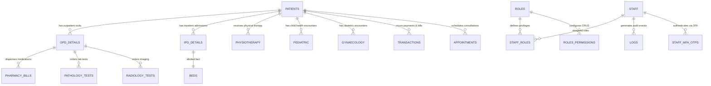

# SEFU HMIS — Database Architecture & Data Dictionary
**Kenya Digital Health Agency (DHA) Certification Compliance Document**  
**Category:** System Documentation — Section D: Database Architecture & Data Dictionary  
**System Classification:** Health Information System (HIS) & Electronic Medical Record (EMR)  
**Database Engine:** MariaDB 10.4+ / MySQL 8.0+ (InnoDB Storage Engine, `utf8mb4_unicode_ci`)

---

## 📋 1. Database Overview & Design Principles

The **SEFU HMIS** relational database is designed according to Third Normal Form (3NF) principles, balancing clinical transactional integrity (ACID compliance) with high-speed query indexing for hospital wards.

### 1.1 Technical Design Highlights
- **Character Encoding:** `utf8mb4` with `utf8mb4_unicode_ci` collation, supporting multilingual clinical documentation.
- **Transactional Integrity:** InnoDB engine enforces foreign key constraints and transactional isolation (`$this->db->trans_start()` and `$this->db->trans_complete()`).
- **Audit Trails:** Master audit tables (`logs`, `userlog`, `staff_mfa_otps`) capture user identifiers, timestamps, IP addresses, user agents, and action types.
- **Index Optimization:** Primary keys (`INT AUTO_INCREMENT`), composite indexes on date/patient queries, and indexed foreign keys ensure sub-second retrieval over large patient cohorts.

---

## 🗺️ 2. Entity-Relationship Architecture (Core Schema)

---

## 📖 3. Comprehensive Data Dictionary (Core Health Tables)

---

### 3.1 Table: `patients` (Master Patient Index)
*Stores core patient demographics, identification, and medical record numbers.*

| Column Name | Data Type | Nullable | Key | Default | Description |
| :--- | :--- | :---: | :---: | :---: | :--- |
| `id` | `INT(11)` | NO | PRI | *Auto* | Unique Master Patient Index (MPI) Identifier. |
| `patient_name` | `VARCHAR(150)` | NO | MUL | NULL | Full legal name of patient. |
| `dob` | `DATE` | YES | | NULL | Date of birth. |
| `age` | `INT(11)` | YES | | NULL | Patient age in years. |
| `month` | `INT(11)` | YES | | NULL | Additional age in months (for infants/pediatrics). |
| `day` | `INT(11)` | YES | | NULL | Additional age in days (for neonates). |
| `gender` | `VARCHAR(20)` | NO | | NULL | Patient gender (Male, Female, Other). |
| `marital_status` | `VARCHAR(50)` | YES | | NULL | Marital status. |
| `blood_group` | `VARCHAR(10)` | YES | | NULL | Blood group (A+, B+, O+, AB+, etc.). |
| `mobileno` | `VARCHAR(30)` | YES | MUL | NULL | Primary contact phone number. |
| `email` | `VARCHAR(150)` | YES | | NULL | Patient contact email address. |
| `address` | `TEXT` | YES | | NULL | Physical residential address. |
| `guardian_name` | `VARCHAR(150)` | YES | | NULL | Next of kin or parent/guardian name. |
| `identification_number`| `VARCHAR(100)`| YES | MUL | NULL | Kenya National ID / Alien ID / Passport Number. |
| `is_active` | `VARCHAR(10)` | NO | | 'yes' | Record status ('yes' active, 'no' disabled). |
| `created_at` | `TIMESTAMP` | NO | | CURRENT | Record creation timestamp. |

---

### 3.2 Table: `physiotherapy` (Physical Therapy Specialty Module)
*Stores physical rehabilitation consultations, pain scoring, and therapy sessions.*

| Column Name | Data Type | Nullable | Key | Default | Description |
| :--- | :--- | :---: | :---: | :---: | :--- |
| `id` | `INT(11)` | NO | PRI | *Auto* | Unique Physiotherapy encounter ID. |
| `bill_no` | `VARCHAR(50)` | NO | MUL | NULL | System-generated billing voucher (`PHYB#`). |
| `patient_id` | `INT(11)` | NO | MUL | NULL | Foreign key referencing `patients.id`. |
| `physiotherapist_id`| `INT(11)` | YES | MUL | NULL | Foreign key referencing `staff.id` (Specialist). |
| `session_date` | `DATETIME` | NO | | NULL | Date and time therapy was administered. |
| `diagnosis` | `TEXT` | YES | | NULL | Clinical diagnosis and presentation. |
| `pain_location` | `VARCHAR(255)` | YES | | NULL | Anatomical location of pain/injury. |
| `pain_scale` | `INT(11)` | YES | | 0 | Visual Analog Pain Scale rating (0 to 10). |
| `treatment_plan`| `TEXT` | YES | | NULL | Rehabilitation protocol and modalities applied. |
| `duration_minutes`| `INT(11)` | YES | | 30 | Duration of therapy session in minutes. |
| `apply_charge` | `DECIMAL(10,2)`| NO | | 0.00 | Net professional service fee charged. |
| `generated_by` | `INT(11)` | NO | | NULL | Staff ID who created the record. |
| `created_at` | `TIMESTAMP` | NO | | CURRENT | Clinical record creation timestamp. |

---

### 3.3 Table: `pediatric` (Pediatric Specialty Module)
*Stores specialized child health records, growth parameters, and developmental consultations.*

| Column Name | Data Type | Nullable | Key | Default | Description |
| :--- | :--- | :---: | :---: | :---: | :--- |
| `id` | `INT(11)` | NO | PRI | *Auto* | Unique Pediatric encounter ID. |
| `bill_no` | `VARCHAR(50)` | NO | MUL | NULL | System-generated billing voucher (`PEDB#`). |
| `patient_id` | `INT(11)` | NO | MUL | NULL | Foreign key referencing `patients.id`. |
| `pediatrician_id`| `INT(11)` | YES | MUL | NULL | Foreign key referencing `staff.id` (Pediatrician). |
| `session_date` | `DATETIME` | NO | | NULL | Consultation date and time. |
| `birth_weight` | `VARCHAR(50)` | YES | | NULL | Neonatal birth weight (kg/g). |
| `current_weight`| `VARCHAR(50)` | YES | | NULL | Weight at current presentation (kg). |
| `height` | `VARCHAR(50)` | YES | | NULL | Stature/length at presentation (cm). |
| `temperature` | `VARCHAR(50)` | YES | | NULL | Body temperature (°C). |
| `diagnosis` | `TEXT` | YES | | NULL | Pediatric clinical diagnosis. |
| `apply_charge` | `DECIMAL(10,2)`| NO | | 0.00 | Net consultation fee charged. |
| `generated_by` | `INT(11)` | NO | | NULL | Staff ID who generated the record. |
| `created_at` | `TIMESTAMP` | NO | | CURRENT | Record creation timestamp. |

---

### 3.4 Table: `gynaecology` (Gynaecology & Obstetrics Specialty Module)
*Stores women's health consultations, obstetric histories, and antenatal tracking.*

| Column Name | Data Type | Nullable | Key | Default | Description |
| :--- | :--- | :---: | :---: | :---: | :--- |
| `id` | `INT(11)` | NO | PRI | *Auto* | Unique Gynaecology encounter ID. |
| `bill_no` | `VARCHAR(50)` | NO | MUL | NULL | System-generated billing voucher (`GYNB#`). |
| `patient_id` | `INT(11)` | NO | MUL | NULL | Foreign key referencing `patients.id`. |
| `gynaecologist_id`| `INT(11)` | YES | MUL | NULL | Foreign key referencing `staff.id` (Specialist). |
| `session_date` | `DATETIME` | NO | | NULL | Consultation date and time. |
| `lmp` | `DATE` | YES | | NULL | Date of Last Menstrual Period. |
| `edd` | `DATE` | YES | | NULL | Calculated Expected Date of Delivery. |
| `gravida` | `VARCHAR(20)` | YES | | NULL | Gravida count (total pregnancies). |
| `para` | `VARCHAR(20)` | YES | | NULL | Para count (viable births). |
| `abortion` | `VARCHAR(20)` | YES | | NULL | Abortion / pregnancy loss count. |
| `clinical_notes`| `TEXT` | YES | | NULL | Gynaecological examination notes. |
| `apply_charge` | `DECIMAL(10,2)`| NO | | 0.00 | Net professional service fee charged. |
| `created_at` | `TIMESTAMP` | NO | | CURRENT | Clinical record creation timestamp. |

---

### 3.5 Table: `logs` (Clinical & Administrative Audit Trails)
*Captures all database record modifications across the entire HMIS for regulatory auditability.*

| Column Name | Data Type | Nullable | Key | Default | Description |
| :--- | :--- | :---: | :---: | :---: | :--- |
| `id` | `INT(11)` | NO | PRI | *Auto* | Unique audit record sequence number. |
| `message` | `TEXT` | YES | | NULL | Human-readable description of change. |
| `record_id` | `INT(11)` | NO | | NULL | Primary key ID of the affected entity. |
| `user_id` | `INT(11)` | YES | MUL | NULL | ID of user who executed the change. |
| `user_type` | `VARCHAR(20)` | NO | | 'staff' | Actor classification ('staff', 'patient', 'system'). |
| `user_role` | `VARCHAR(50)` | NO | | 'Staff' | Actor role at time of change ('Doctor', 'HR', etc.). |
| `user_name` | `VARCHAR(150)`| YES | | NULL | Resolved display name at the moment of action. |
| `action` | `VARCHAR(50)` | NO | | NULL | SQL Action type ('Insert', 'Update', 'Delete'). |
| `ip_address` | `VARCHAR(50)` | NO | | NULL | Origin IPv4 or IPv6 client address. |
| `platform` | `VARCHAR(50)` | NO | | NULL | Operating system platform of client. |
| `agent` | `VARCHAR(50)` | NO | | NULL | Browser / User-Agent signature. |
| `time` | `TIMESTAMP` | NO | | CURRENT | Exact timestamp of execution. |
| `created_at` | `DATE` | YES | | NULL | Calendar date of action. |

---

### 3.6 Table: `staff_mfa_otps` (Multi-Factor Authentication Engine)
*Manages 2FA Email OTP tokens, expiration, and brute-force lockout states.*

| Column Name | Data Type | Nullable | Key | Default | Description |
| :--- | :--- | :---: | :---: | :---: | :--- |
| `id` | `INT(11)` | NO | PRI | *Auto* | Unique token sequence number. |
| `staff_id` | `INT(11)` | NO | MUL | NULL | Foreign key referencing `staff.id`. |
| `otp_code` | `VARCHAR(10)` | NO | MUL | NULL | Cryptographic 6-digit numeric token. |
| `email` | `VARCHAR(150)`| NO | | NULL | Destination email address. |
| `expires_at` | `DATETIME` | NO | | NULL | Token expiration timestamp (10 minutes). |
| `is_used` | `TINYINT(1)` | NO | | 0 | State (`0=active`, `1=used`, `2=superseded`, `3=expired`, `4=locked`). |
| `attempts` | `INT(11)` | NO | | 0 | Failed verification attempt counter (Lockout at 5). |
| `ip_address` | `VARCHAR(50)` | YES | | NULL | Client IP requesting the token. |
| `created_at` | `TIMESTAMP` | NO | | CURRENT | Token issuance timestamp. |

---

**Certified by:**  
*Lead Database Architect & CTO*  
*SEFU Health Systems — Kenya Digital Health Agency (DHA) Compliance Sign-Off*

