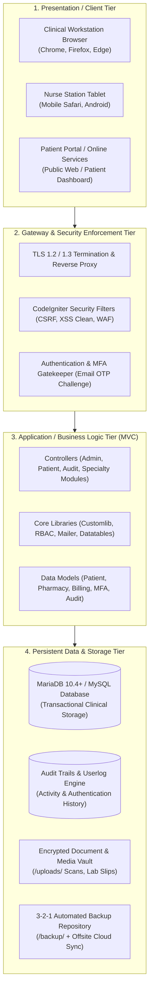

# SEFU HMIS — Functional & System Requirements Specification (FRS / SRS)
**Kenya Digital Health Agency (DHA) Certification Compliance Document**  
**Category:** System Documentation — Section D: Technical & Functional Specification  
**System Classification:** Health Information System (HIS) & Electronic Medical Record (EMR)  
**Applicable Regulations:** Kenya Health Information Management Procedures Regulations 2025 (Form HMIS 4), Kenya Digital Health Act 2023, Kenya Data Protection Act 2019

---

## 📋 1. Document Control & System Release Metadata

| Attribute | Specification |
| :--- | :--- |
| **Document Title** | Functional Requirements Specification (FRS) & System Requirements Specification (SRS) |
| **System Name** | SEFU Hospital Management Information System (SEFU HMIS) |
| **System Version** | Release 5.0 (Build 2026-Kenya-DHA) |
| **Document Version** | 1.0 (Production Release / Statutory Certification Filing) |
| **Document Owner** | Chief Technology Officer & Lead Solutions Architect |
| **Target Reviewers** | Kenya Digital Health Agency (DHA) Evaluation Team & Hospital Technical Committees |
| **Effective Date** | November 2026 |
| **Classification** | Public Release Technical Document — Kenya Statutory Filing |

---

## 🎯 2. System Overview & Executive Summary

The **SEFU Hospital Management Information System (SEFU HMIS)** is an enterprise, modular digital health solution designed to manage inpatient, outpatient, diagnostic, pharmaceutical, surgical, and financial healthcare workflows.

Built on an optimized **Model-View-Controller (MVC)** architecture, SEFU HMIS provides digital medical records, real-time clinical decision documentation, automated itemized billing, multi-factor authentication (MFA), immutable audit trails, and granular Role-Based Access Control (RBAC).

---

## 🏗️ 3. High-Level System Architecture

SEFU HMIS utilizes a robust 4-tier modular architecture designed for high availability, security isolation, and rapid data throughput:

---

## 💻 4. Technical System Requirements Specification (SRS)

### 4.1 Server Infrastructure Requirements (Production Hospital Deployment)

| Hardware / Resource | Minimum Baseline (Level 3-4 Hospital) | Recommended Enterprise (Level 5-6 Hospital) |
| :--- | :--- | :--- |
| **Processor (CPU)** | 4 Cores (2.4 GHz x86-64) | 8 to 16 Cores (Intel Xeon / AMD EPYC) |
| **System Memory (RAM)** | 8 GB DDR4 | 16 GB to 32 GB DDR4/DDR5 |
| **Storage (Database)** | 250 GB NVMe SSD (RAID 1 Mirror) | 1 TB NVMe SSD (RAID 10 Redundant Array) |
| **Storage (Media / Scans)** | 500 GB Storage | 2 TB Dedicated Storage Server / NAS |
| **Network Interface** | 1 Gbps Dedicated Ethernet | Dual 10 Gbps Redundant NICs (Bonded) |
| **Power Infrastructure** | Online Double-Conversion UPS (45 min) | Dual UPS + Automated Diesel Generator (< 12s ATS) |

### 4.2 Software Technology Stack

| Stack Component | Specified Technology | Purpose & Capabilities |
| :--- | :--- | :--- |
| **Operating System** | Ubuntu 22.04 LTS / Windows Server 2022 | Enterprise host server environment |
| **Web Server** | Apache 2.4 / Nginx (HTTP/2 enabled) | Request handling, virtual hosts, SSL termination |
| **Application Runtime** | PHP 8.1 / 8.2 (with FPM) | Server-side execution engine |
| **Core Framework** | CodeIgniter 3.1.13 (Hardened) | High-throughput MVC application framework |
| **Database Engine** | MariaDB 10.4+ / MySQL 8.0+ | Relational, ACID-compliant health database |
| **Cryptographic Engine** | OpenSSL (AES-256 / SHA-256) | In-transit and at-rest cryptographic validation |
| **Client Interface** | HTML5, Bootstrap 3.3.7, jQuery, CSS3 | Responsive interface optimized for desktops and tablets |

---

## ⚙️ 5. Functional Requirements Specification (FRS) by Module

### 5.1 Patient Identification & Master Patient Index (MPI)
- **FR-01 (Registration):** Capture patient name, national/alien ID, gender, DOB, marital status, phone, email, and address.
- **FR-02 (Unique Identifier):** System automatically generates an immutable alphanumeric patient ID.
- **FR-03 (Search & Demographics):** Fast indexed search across patient ID, mobile number, national ID, and patient name.

### 5.2 Outpatient Department (OPD)
- **FR-04 (Visit Intake):** Create new clinical visits, assign consulting physician, and record vitals (BP, pulse, height, weight, BMI).
- **FR-05 (Clinical Notes):** Record presenting symptoms, clinical observations, physical exam, diagnosis, and ICD-10 codes.
- **FR-06 (Prescription Writing):** Electronic prescribing linked to hospital pharmacy stock, with dosage, interval, and instructions.

### 5.3 Inpatient Department (IPD)
- **FR-07 (Admission & Bed Management):** Allot inpatient beds by ward category (ICU, General, Private, Maternity).
- **FR-08 (Inpatient Charting):** Consultant visit log, medication administration record (MAR), nurse notes, and treatment progress.
- **FR-09 (Discharge Summaries):** Comprehensive medical discharge summary generation including treatment summary and follow-up advice.

### 5.4 Specialty Clinical Modules
- **FR-10 (Physiotherapy Module):** Specialized assessment of muscular/skeletal pain, pain scale (1–10), anatomical location, therapy session duration, specialized equipment, session progress, and automated billing voucher (`PHYB`).
- **FR-11 (Pediatric Module):** Pediatric intake capturing exact birth date, day/month age calculation, guardian details, birth weight, delivery mode, immunization tracking, pediatric consultations, and automated billing voucher (`PEDB`).
- **FR-12 (Gynaecology Module):** Women's health clinical documentation capturing Last Menstrual Period (LMP), Expected Date of Delivery (EDD), Gravida/Para/Abortion (GPA) obstetric history, antenatal visits, and automated billing voucher (`GYNB`).

### 5.5 Diagnostics (Laboratory & Radiology)
- **FR-13 (Pathology):** Test ordering, barcode sample tracking, reference range validation, test parameter entry, and pathologist approval.
- **FR-14 (Radiology):** Diagnostic imaging requests (X-Ray, Ultrasound, CT, MRI), clinical indications, and radiologist reporting.

### 5.6 Pharmacy & Medication Management
- **FR-15 (Medicine Inventory):** Medicine category, supplier, batch number, manufacturing date, and expiry date alerts.
- **FR-16 (Dispensing & Invoicing):** Automated reduction of stock upon dispensing, POS billing, and expiry warnings.

### 5.7 Hospital Billing, Cashier & TPA Insurance
- **FR-17 (Itemized Billing):** Automated aggregation of bed charges, consultations, procedures, lab tests, and medications.
- **FR-18 (Insurance / TPA Mapping):** Policy numbers, approval codes, co-pays, and insurance claim voucher exports.
- **FR-19 (Cashier Receipts):** Official receipts with Kenya Shilling (KES) currency and hospital branding.

### 5.8 Information Security, MFA & Auditing
- **FR-20 (Password Security):** Enforce 8+ character password complexity with Bcrypt hashing (`$2y$10$...`).
- **FR-21 (Multi-Factor Authentication):** Enforce 6-digit Email OTP with 10-minute validity and 5-attempt brute-force lockout for staff.
- **FR-22 (Audit Logging):** Immutable recording of every Insert, Update, and Delete action in `logs` table with staff ID and role attribution.
- **FR-23 (Session Management):** Automatic 2-hour idle timeout, 5-minute session ID rotation, and `HttpOnly`/`SameSite` cookie flags.

---

## 👥 6. Role-Based Access Control (RBAC) Matrix

SEFU HMIS enforces 13 specialized roles, each configured with granular CRUD permissions:

| Role ID | Role Name | System Access Scope | Default Permissions |
| :---: | :--- | :--- | :--- |
| **1** | **Admin** | Full operational administration | Full CRUD on all modules, Reports, Staff management |
| **2** | **Accountant** | Financial and cashier management | Full access to Billing, Income, Expenses, Financial Reports |
| **3** | **Doctor** | Inpatient and Outpatient clinical care | View/Edit Patients, OPD/IPD consultations, Prescriptions |
| **4** | **Pharmacist** | Pharmacy inventory & dispensing | Full access to Pharmacy, Medicine stock, Medicine billing |
| **5** | **Pathologist** | Laboratory diagnostics | Full access to Pathology tests, parameters, and lab results |
| **6** | **Radiologist** | Medical imaging | Full access to Radiology orders, scans, and reports |
| **7** | **Super Admin** | Complete root system authority | Root privileges across entire database, server, and settings |
| **8** | **Receptionist** | Front office, appointments, triage | Patient registration, Appointments, Visitor log, Bed view |
| **9** | **Nurse** | Ward management & patient care | Vital signs, Medication administration, Nurse notes |
| **10** | **Physiotherapist**| Physical therapy specialty | Physiotherapy assessment, sessions, and treatment notes |
| **11** | **Pediatrician** | Child healthcare specialty | Pediatric growth tracking, immunizations, and clinical notes |
| **12** | **Gynaecologist** | Women's health specialty | Antenatal records, LMP/EDD tracking, obstetric consultations |
| **13** | **Human Resource**| Staff management & system auditing | Staff directory, Payroll, Attendance, **Audit Trails & User Logs** |

---

**Approved by:**  
*Chief Technology Officer & Lead Solutions Architect*  
*SEFU Health Systems — Kenya Digital Health Agency (DHA) Compliance*

